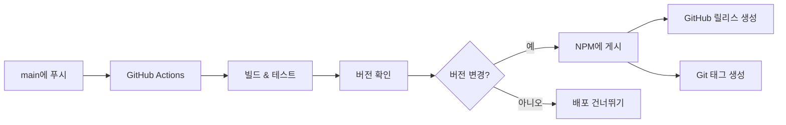

[](README.md)
[](README-ko.md)

# AIM Guard MCP

[](https://archestra.ai/mcp-catalog/AIM-Intelligence__AIM-MCP)
[](https://smithery.ai/server/@AIM-Intelligence/aim-mcp)

[](https://www.npmjs.com/package/aim-guard-mcp)
[](https://smithery.ai/server/@AIM-Intelligence/aim-mcp)

🛡️ **AIM MCP Server :: MCP 및 AI 에이전트를 보호하고 방어하세요**

AI 기반 보안 분석 및 안전 지시 도구를 제공하는 Model Context Protocol (MCP) 서버입니다. 이 서버는 다양한 MCP 및 외부 서비스와 상호 작용할 때 보안 지침, 콘텐츠 분석 및 주의 사항을 제공하여 AI 에이전트를 보호하는 데 도움을 줍니다.

<a href="https://glama.ai/mcp/servers/@AIM-Intelligence/AIM-MCP">
  
</a>

## 기능

### 🔧 도구 (총 6개)

- 🛡️ **AI 안전 가드**: MCP 상호 작용을 위한 맥락적 보안 지침
- 🔍 **텍스트 가드 분석**: AIM Intelligence API를 사용한 유해 콘텐츠 감지
- 🔒 **보안 프롬프트 강화**: 사용자 프롬프트에 보안 레이어 추가
- 🚨 **프롬프트 인젝션 탐지기**: OWASP LLM01:2025 준수 인젝션 탐지
- 🔐 **자격 증명 스캐너**: 노출된 API 키, 비밀번호, 토큰 및 시크릿 검색
- 🌐 **URL 보안 검증기**: 피싱, 악성코드 및 HTTPS 적용에 대한 URL 검증

### 📚 리소스 (총 9개)

- 📋 **보안 체크리스트**: MCP별 보안 체크리스트 (데이터베이스, 이메일, 슬랙, 파일, 웹, 일반)
- 📖 **보안 정책**: 포괄적인 정책 (데이터 분류, 접근 제어, 사고 대응)

### 💬 프롬프트 (총 2개)

- 🔍 **보안 검토**: 다단계 보안 검토 워크플로우
- ⚠️ **위협 분석**: STRIDE 기반 위협 모델링 및 위험 평가

### 🎯 일반

- ⚡ **빠르고 가벼움**: TypeScript와 Zod 검증으로 구축
- 🔧 **쉬운 통합**: 모든 MCP 호환 AI 어시스턴트와 작동
- 🔗 **API 통합**: 고급 분석을 위한 AIM Intelligence API 연결
- 📚 **포괄적인 문서**: 도구, 리소스 및 프롬프트에 대한 상세한 가이드

## 설치

### Smithery를 통한 설치

[Smithery](https://smithery.ai/server/@AIM-Intelligence/aim-mcp)를 통해 Claude Desktop에 aim-mcp를 자동으로 설치하려면:

```bash
npx -y @smithery/cli install @AIM-Intelligence/aim-mcp --client claude
```

### NPX (권장)

```bash
npx aim-guard-mcp
```

### 전역 설치

```bash
npm install -g aim-guard-mcp
aim-guard-mcp
```

### 로컬 설치

```bash
npm install aim-guard-mcp
```

## 사용법

### MCP 서버로 사용

MCP 클라이언트 설정에 추가:

```json
{
  "servers": {
    "aim-guard": {
      "type": "stdio",
      "command": "npx",
      "args": ["aim-guard-mcp"]
    }
  }
}
```

### 도구 테스트

#### AI 안전 가드 테스트

```bash
# 데이터베이스 작업에 대한 안전 지침 가져오기
{
  "name": "ai-safety-guard",
  "arguments": {
    "mcp_type": "database",
    "operation_type": "query",
    "sensitivity_level": "confidential"
  }
}
```

#### 텍스트 가드 테스트

```bash
# 텍스트의 유해 콘텐츠 분석
{
  "name": "aim-text-guard",
  "arguments": {
    "text": "안전성을 분석할 샘플 텍스트입니다."
  }
}
```

#### 보안 프롬프트 강화 테스트

```bash
# 보안 지침으로 사용자 프롬프트 강화
{
  "name": "aim-security-prompt-tool",
  "arguments": {
    "user_prompt": "이 작업을 도와주세요",
    "security_level": "strict"
  }
}
```

### 사용 가능한 도구

#### 1. `ai-safety-guard`

AI 에이전트가 다른 MCP와 상호 작용하기 전에 맥락적 보안 지침 및 주의 사항을 제공합니다.

```json
{
  "name": "ai-safety-guard",
  "arguments": {
    "mcp_type": "email|slack|database|file|web|general",
    "operation_type": "read|write|execute|delete|send|query",
    "sensitivity_level": "public|internal|confidential|restricted"
  }
}
```

**기능**: 컨텍스트 인식 가이드라인, 작업별 경고, 위험 신호 감지

#### 2. `aim-text-guard`

AIM Intelligence API를 사용하여 유해하거나 부적절한 콘텐츠에 대한 텍스트 콘텐츠를 분석합니다.

```json
{
  "name": "aim-text-guard",
  "arguments": {
    "text": "분석할 텍스트 콘텐츠"
  }
}
```

**기능**: 실시간 분석, 유해 콘텐츠 감지, 상세한 JSON 결과

#### 3. `aim-security-prompt-tool`

더 안전한 AI 상호 작용을 위해 사용자 프롬프트를 보안 지침으로 강화합니다.

```json
{
  "name": "aim-security-prompt-tool",
  "arguments": {
    "user_prompt": "원본 사용자 프롬프트",
    "security_level": "basic|standard|strict"
  }
}
```

**기능**: 다단계 강화, 위협 분석, 소셜 엔지니어링 보호

#### 4. `prompt-injection-detector` 🆕

OWASP LLM01:2025 패턴을 기반으로 프롬프트 인젝션 시도를 감지합니다.

```json
{
  "name": "prompt-injection-detector",
  "arguments": {
    "text": "인젝션 패턴을 분석할 텍스트",
    "sensitivity": "low|medium|high"
  }
}
```

**기능**:

- 15개 이상의 인젝션 패턴 감지 (지시 덮어쓰기, 역할 조작, 탈옥 시도)
- 심각도 평가를 통한 위험 점수 (0-100)
- OWASP LLM01:2025 준수
- 구성 가능한 민감도 수준
- 상세한 위협 보고

#### 5. `credential-scanner` 🆕

API 키, 비밀번호, 토큰 및 SSH 키를 포함한 노출된 자격 증명에 대한 텍스트 검색.

```json
{
  "name": "credential-scanner",
  "arguments": {
    "text": "자격 증명을 검색할 텍스트",
    "mask_findings": true
  }
}
```

**기능**:

- 50개 이상의 자격 증명 패턴 (AWS, GitHub, Google, OpenAI, Stripe, JWT, SSH 키)
- 자동 자격 증명 마스킹
- 위험 수준 평가
- 플랫폼별 감지 (AWS, GitHub, Slack, 데이터베이스)
- 실행 가능한 보안 권장 사항

#### 6. `url-security-validator` 🆕

피싱, 악성코드 및 보안 문제에 대한 URL 안전성 검증.

```json
{
  "name": "url-security-validator",
  "arguments": {
    "url": "검증할 URL",
    "strict_mode": false
  }
}
```

**기능**:

- 10개 이상의 보안 검사 (프로토콜, TLD, IP 주소, 호모그래프 공격)
- 피싱 도메인 감지
- URL 단축기 식별
- 의심스러운 매개변수 감지
- HTTPS 적용 검증

### 사용 가능한 리소스 🆕

리소스는 URI 스키마를 통해 접근 가능한 읽기 전용 보안 문서 및 정책을 제공합니다.

#### 보안 체크리스트

`security-checklist://[type]`를 통해 접근

- `security-checklist://database` - 데이터베이스 작업 체크리스트
- `security-checklist://email` - 이메일 작업 체크리스트
- `security-checklist://slack` - 채팅/메시징 작업 체크리스트
- `security-checklist://file` - 파일 작업 체크리스트
- `security-checklist://web` - 웹 요청 체크리스트
- `security-checklist://general` - 일반 MCP 작업 체크리스트

**각 체크리스트 포함 내용**:

- 작업 전 확인 사항
- 작업 중 가이드라인
- 작업 후 검증
- 작업 중단을 위한 위험 신호

#### 보안 정책

`security-policy://[type]`를 통해 접근

- `security-policy://data-classification` - 데이터 분류 수준 및 처리 요구 사항
- `security-policy://access-control` - 접근 제어 원칙 및 인증 요구 사항
- `security-policy://incident-response` - 사고 대응 절차 및 심각도 수준

### 사용 가능한 프롬프트 🆕

프롬프트는 복잡한 보안 작업을 위한 재사용 가능한 워크플로우 템플릿을 제공합니다.

#### 1. `security-review`

코드, 데이터 또는 구성에 대한 포괄적인 보안 검토 워크플로우.

```json
{
  "name": "security-review",
  "arguments": {
    "target_type": "code|data|configuration",
    "context": "추가 컨텍스트 (선택 사항)"
  }
}
```

**워크플로우**:

1. 자격 증명 스캔
2. 프롬프트 인젝션 감지 (해당하는 경우)
3. 보안 체크리스트 참조
4. 정책 준수 검토
5. 위협 분석
6. 위험 평가 및 권장 사항
7. **요약 테이블** - 심각도별 모든 결과의 시각적 개요

**요약 출력 예시**:

```
📊 요약

| 심각도         | 개수  | 파일/위치                  |
|-------------|-----|------------------------|
| 🔴 CRITICAL | 1   | resources/handler.ts   |
| 🟠 HIGH     | 2   | textGuard.ts           |
| 🟡 MEDIUM   | 3   | prompts/handler.ts     |
| 🟢 LOW      | 5   | credentialScanner.ts   |
```

#### 2. `threat-analysis`

STRIDE 방법론을 사용하여 잠재적 보안 위협을 분석합니다.

```json
{
  "name": "threat-analysis",
  "arguments": {
    "scenario": "분석할 보안 시나리오",
    "sensitivity_level": "public|internal|confidential|restricted"
  }
}
```

**프레임워크**:

1. 자산 식별
2. STRIDE 위협 모델링 (스푸핑, 변조, 부인 방지, 정보 공개, DoS, 권한 상승)
3. 위험 평가 (가능성 × 영향)
4. 공격 벡터 분석
5. 제어 격차 식별
6. 완화 전략
7. 규정 준수 고려 사항
8. 사고 대응 계획
9. **요약 테이블** - 심각도별 모든 위협의 시각적 개요

**요약 출력 예시**:

```
📊 요약

| 심각도         | 개수  | 위협 유형                           |
|-------------|-----|---------------------------------|
| 🔴 CRITICAL | 2   | Information Disclosure, Spoofing |
| 🟠 HIGH     | 1   | Elevation of Privilege           |
| 🟡 MEDIUM   | 3   | Tampering, DoS                   |
| 🟢 LOW      | 1   | Repudiation                      |
```

## 보안 기능

### 🛡️ AI 에이전트 보호

- **MCP 상호 작용 안전**: 다양한 MCP 유형에 대한 맥락적 가이드라인
- **작업 검증**: 읽기/쓰기/실행 작업에 대한 특정 주의 사항
- **데이터 민감도 처리**: 데이터 분류 수준에 기반한 프로토콜

### 🔍 콘텐츠 분석

- **실시간 위협 감지**: 유해한 패턴에 대한 콘텐츠 분석
- **프롬프트 인젝션 감지**: OWASP LLM01:2025 준수 패턴 매칭
- **자격 증명 노출 방지**: 50개 이상의 노출된 시크릿 유형 검색
- **API 기반 분석**: 고급 AI 기반 콘텐츠 안전성 평가

### 🌐 URL 보안

- **피싱 감지**: 의심스러운 도메인 및 호모그래프 공격 식별
- **HTTPS 적용**: 안전한 프로토콜 사용 검증
- **악성 URL 차단**: 알려진 위협 지표 확인

### 📚 정책 및 준수

- **보안 체크리스트**: 모든 MCP 유형에 대한 사전 구축된 체크리스트
- **데이터 분류**: 민감한 데이터 처리를 위한 명확한 정책
- **접근 제어**: 인증 및 권한 부여 가이드라인
- **사고 대응**: 보안 사고에 대한 구조화된 절차

### 🔒 워크플로우 오케스트레이션

- **보안 검토 프롬프트**: 다단계 검토 워크플로우
- **위협 분석**: STRIDE 기반 위협 모델링
- **자동화된 감사**: 포괄적인 검사를 위한 여러 도구 결합

## 개발

```bash
# 저장소 복제
git clone https://github.com/AIM-Intelligence/AIM-MCP.git
cd AIM-MCP

# 의존성 설치
pnpm install

# 프로젝트 빌드
pnpm run build

# 개발 모드로 실행
pnpm run dev

# 테스트 실행
pnpm test
```

## 배포

이 프로젝트는 NPM에 원활하게 배포하기 위한 자동화된 CI/CD 파이프라인을 사용합니다.

### 자동 배포

`main` 브랜치에 푸시하면 GitHub Actions가 자동으로:

1. **빌드 및 테스트**: TypeScript 컴파일 및 테스트 실행
2. **버전 확인**: 현재 버전과 게시된 버전 비교
3. **NPM에 게시**: 버전이 변경되면 자동으로 게시
4. **릴리스 생성**: 버전 태그와 함께 GitHub 릴리스 생성

### 수동 버전 관리

```bash
# 패치 버전 증가 (1.0.0 -> 1.0.1)
pnpm run release:patch

# 마이너 버전 증가 (1.0.0 -> 1.1.0)
pnpm run release:minor

# 메이저 버전 증가 (1.0.0 -> 2.0.0)
pnpm run release:major
```

### NPM 토큰 설정

자동 배포를 활성화하려면 GitHub Secrets에 NPM 토큰을 추가하세요:

1. [npmjs.com](https://www.npmjs.com)으로 이동하여 자동화 토큰 생성
2. GitHub 저장소에서 Settings > Secrets and variables > Actions로 이동
3. NPM 토큰 값으로 `NPM_TOKEN`이라는 새 시크릿 추가

### 배포 워크플로우



## 기여하기

1. 저장소 포크
2. 기능 브랜치 생성 (`git checkout -b feature/amazing-feature`)
3. 변경 사항 커밋 (`git commit -m 'Add some amazing feature'`)
4. 브랜치에 푸시 (`git push origin feature/amazing-feature`)
5. Pull Request 열기

## 라이선스

이 프로젝트는 ISC 라이선스를 따릅니다 - 자세한 내용은 [LICENSE](LICENSE) 파일을 참조하세요.

## 문서

- 📚 **[MCP 구성 요소 가이드](./MCP_COMPONENTS_GUIDE.md)**: 도구, 리소스 및 프롬프트에 대한 포괄적인 가이드
- 📖 **[GitHub Wiki](https://github.com/AIM-Intelligence/AIM-MCP/wiki)**: 추가 문서 및 예제
- 🔍 **[MCP 사양](https://modelcontextprotocol.io/)**: 공식 Model Context Protocol 문서

## 지원

- 📧 이메일: support@aim-intelligence.com
- 🐛 이슈: [GitHub Issues](https://github.com/AIM-Intelligence/AIM-MCP/issues)
- 💬 토론: [GitHub Discussions](https://github.com/AIM-Intelligence/AIM-MCP/discussions)

---

[AIM Intelligence](https://github.com/AIM-Intelligence)가 ❤️를 담아 제작했습니다
