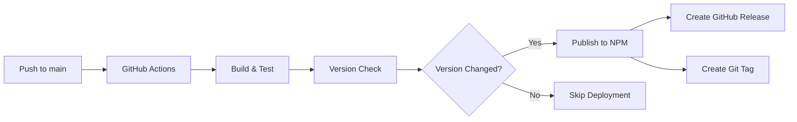

[](README.md)
[](README-ko.md)

# AIM Guard MCP
[](https://archestra.ai/mcp-catalog/AIM-Intelligence__AIM-MCP)
[](https://smithery.ai/server/@AIM-Intelligence/aim-mcp)

[](https://www.npmjs.com/package/aim-guard-mcp)
[](https://smithery.ai/server/@AIM-Intelligence/aim-mcp)

🛡️ **AIM MCP Server :: Guard and Protect your MCPs & AI Agents**

A Model Context Protocol (MCP) server that provides AI-powered security analysis and safety instruction tools. This server helps protect AI agents by providing security guidelines, content analysis, and cautionary instructions when interacting with various MCPs and external services.

<a href="https://glama.ai/mcp/servers/@AIM-Intelligence/AIM-MCP">
  
</a>

## Features

### 🔧 Tools (6 total)
- 🛡️ **AI Safety Guard**: Contextual security instructions for MCP interactions
- 🔍 **Text Guard Analysis**: Harmful content detection using AIM Intelligence API
- 🔒 **Security Prompt Enhancement**: Add security layers to user prompts
- 🚨 **Prompt Injection Detector**: OWASP LLM01:2025 compliant injection detection
- 🔐 **Credential Scanner**: Scan for exposed API keys, passwords, tokens, and secrets
- 🌐 **URL Security Validator**: Validate URLs for phishing, malware, and HTTPS enforcement

### 📚 Resources (9 total)
- 📋 **Security Checklists**: MCP-specific security checklists (database, email, slack, file, web, general)
- 📖 **Security Policies**: Comprehensive policies (data classification, access control, incident response)

### 💬 Prompts (2 total)
- 🔍 **Security Review**: Multi-step security review workflow
- ⚠️ **Threat Analysis**: STRIDE-based threat modeling and risk assessment

### 🎯 General
- ⚡ **Fast & Lightweight**: Built with TypeScript and Zod validation
- 🔧 **Easy Integration**: Works with any MCP-compatible AI assistant
- 🔗 **API Integration**: Connects to AIM Intelligence API for advanced analysis
- 📚 **Comprehensive Documentation**: Detailed guide for Tools, Resources, and Prompts

## Installation

### Installing via Smithery

To install aim-mcp for Claude Desktop automatically via [Smithery](https://smithery.ai/server/@AIM-Intelligence/aim-mcp):

```bash
npx -y @smithery/cli install @AIM-Intelligence/aim-mcp --client claude
```

### NPX (Recommended)

```bash
npx aim-guard-mcp
```

### Global Installation

```bash
npm install -g aim-guard-mcp
aim-guard-mcp
```

### Local Installation

```bash
npm install aim-guard-mcp
```

## Usage

### As MCP Server

Add to your MCP client configuration:

```json
{
  "servers": {
    "aim-guard": {
      "type": "stdio",
      "command": "npx",
      "args": ["aim-guard-mcp"]
    }
  }
}
```

### Testing the Tools

#### Test AI Safety Guard

```bash
# Get safety instructions for database operations
{
  "name": "ai-safety-guard",
  "arguments": {
    "mcp_type": "database",
    "operation_type": "query",
    "sensitivity_level": "confidential"
  }
}
```

#### Test Text Guard

```bash
# This will analyze the text for harmful content
{
  "name": "aim-text-guard",
  "arguments": {
    "text": "This is a sample text to analyze for safety."
  }
}
```

#### Test Security Prompt Enhancement

```bash
# Enhance a user prompt with security instructions
{
  "name": "aim-security-prompt-tool",
  "arguments": {
    "user_prompt": "Please help me with this task",
    "security_level": "strict"
  }
}
```

### Available Tools

#### 1. `ai-safety-guard`

Provides contextual security instructions and precautions for AI Agents before they interact with other MCPs.

```json
{
  "name": "ai-safety-guard",
  "arguments": {
    "mcp_type": "email|slack|database|file|web|general",
    "operation_type": "read|write|execute|delete|send|query",
    "sensitivity_level": "public|internal|confidential|restricted"
  }
}
```

**Features**: Context-aware guidelines, operation-specific warnings, red flag detection

#### 2. `aim-text-guard`

Analyze text content for harmful or inappropriate content using AIM Intelligence API.

```json
{
  "name": "aim-text-guard",
  "arguments": {
    "text": "Text content to analyze"
  }
}
```

**Features**: Real-time analysis, harmful content detection, detailed JSON results

#### 3. `aim-security-prompt-tool`

Enhance user prompts with security instructions for safer AI interactions.

```json
{
  "name": "aim-security-prompt-tool",
  "arguments": {
    "user_prompt": "Original user prompt",
    "security_level": "basic|standard|strict"
  }
}
```

**Features**: Multi-level enhancement, threat analysis, social engineering protection

#### 4. `prompt-injection-detector` 🆕

Detect prompt injection attempts based on OWASP LLM01:2025 patterns.

```json
{
  "name": "prompt-injection-detector",
  "arguments": {
    "text": "Text to analyze for injection patterns",
    "sensitivity": "low|medium|high"
  }
}
```

**Features**:
- 15+ injection pattern detection (instruction override, role manipulation, jailbreak attempts)
- Risk scoring (0-100) with severity assessment
- OWASP LLM01:2025 compliant
- Configurable sensitivity levels
- Detailed threat reporting

#### 5. `credential-scanner` 🆕

Scan text for exposed credentials including API keys, passwords, tokens, and SSH keys.

```json
{
  "name": "credential-scanner",
  "arguments": {
    "text": "Text to scan for credentials",
    "mask_findings": true
  }
}
```

**Features**:
- 50+ credential patterns (AWS, GitHub, Google, OpenAI, Stripe, JWT, SSH keys)
- Automatic credential masking
- Risk level assessment
- Platform-specific detection (AWS, GitHub, Slack, databases)
- Actionable security recommendations

#### 6. `url-security-validator` 🆕

Validate URL safety for phishing, malware, and security issues.

```json
{
  "name": "url-security-validator",
  "arguments": {
    "url": "URL to validate",
    "strict_mode": false
  }
}
```

**Features**:
- 10+ security checks (protocol, TLD, IP address, homograph attacks)
- Phishing domain detection
- URL shortener identification
- Suspicious parameter detection
- HTTPS enforcement validation

### Available Resources 🆕

Resources provide read-only security documentation and policies accessible via URI schemes.

#### Security Checklists

Access via `security-checklist://[type]`

- `security-checklist://database` - Database operations checklist
- `security-checklist://email` - Email operations checklist
- `security-checklist://slack` - Chat/messaging operations checklist
- `security-checklist://file` - File operations checklist
- `security-checklist://web` - Web request checklist
- `security-checklist://general` - General MCP operations checklist

**Each checklist includes**:
- Pre-operation checks
- During-operation guidelines
- Post-operation verification
- Red flags to abort operations

#### Security Policies

Access via `security-policy://[type]`

- `security-policy://data-classification` - Data classification levels and handling requirements
- `security-policy://access-control` - Access control principles and authentication requirements
- `security-policy://incident-response` - Incident response procedures and severity levels

### Available Prompts 🆕

Prompts provide reusable workflow templates for complex security operations.

#### 1. `security-review`

Comprehensive security review workflow for code, data, or configuration.

```json
{
  "name": "security-review",
  "arguments": {
    "target_type": "code|data|configuration",
    "context": "Additional context (optional)"
  }
}
```

**Workflow**:
1. Credential scanning
2. Prompt injection detection (if applicable)
3. Security checklist consultation
4. Policy compliance review
5. Threat analysis
6. Risk assessment and recommendations
7. **Summary table** - Visual overview of all findings by severity

**Summary Output Example**:
```
📊 요약

| 심각도         | 개수  | 파일/위치                  |
|-------------|-----|------------------------|
| 🔴 CRITICAL | 1   | resources/handler.ts   |
| 🟠 HIGH     | 2   | textGuard.ts           |
| 🟡 MEDIUM   | 3   | prompts/handler.ts     |
| 🟢 LOW      | 5   | credentialScanner.ts   |
```

#### 2. `threat-analysis`

Analyze potential security threats using STRIDE methodology.

```json
{
  "name": "threat-analysis",
  "arguments": {
    "scenario": "Security scenario to analyze",
    "sensitivity_level": "public|internal|confidential|restricted"
  }
}
```

**Framework**:
1. Asset identification
2. STRIDE threat modeling (Spoofing, Tampering, Repudiation, Information Disclosure, DoS, Elevation of Privilege)
3. Risk assessment (likelihood × impact)
4. Attack vector analysis
5. Control gap identification
6. Mitigation strategies
7. Compliance considerations
8. Incident response planning
9. **Summary table** - Visual overview of all threats by severity

**Summary Output Example**:
```
📊 요약

| 심각도         | 개수  | 위협 유형                           |
|-------------|-----|---------------------------------|
| 🔴 CRITICAL | 2   | Information Disclosure, Spoofing |
| 🟠 HIGH     | 1   | Elevation of Privilege           |
| 🟡 MEDIUM   | 3   | Tampering, DoS                   |
| 🟢 LOW      | 1   | Repudiation                      |
```

## Security Features

### 🛡️ AI Agent Protection

- **MCP Interaction Safety**: Contextual guidelines for different MCP types
- **Operation Validation**: Specific precautions for read/write/execute operations
- **Data Sensitivity Handling**: Protocols based on data classification levels

### 🔍 Content Analysis

- **Real-time Threat Detection**: Analyze content for harmful patterns
- **Prompt Injection Detection**: OWASP LLM01:2025 compliant pattern matching
- **Credential Exposure Prevention**: Scan for 50+ types of exposed secrets
- **API-powered Analysis**: Advanced AI-driven content safety assessment

### 🌐 URL Security

- **Phishing Detection**: Identify suspicious domains and homograph attacks
- **HTTPS Enforcement**: Validate secure protocol usage
- **Malicious URL Blocking**: Check against known threat indicators

### 📚 Policy & Compliance

- **Security Checklists**: Pre-built checklists for all MCP types
- **Data Classification**: Clear policies for handling sensitive data
- **Access Control**: Guidelines for authentication and authorization
- **Incident Response**: Structured procedures for security incidents

### 🔒 Workflow Orchestration

- **Security Review Prompts**: Multi-step review workflows
- **Threat Analysis**: STRIDE-based threat modeling
- **Automated Audits**: Combine multiple tools for comprehensive checks

## Development

```bash
# Clone the repository
git clone https://github.com/AIM-Intelligence/AIM-MCP.git
cd AIM-MCP

# Install dependencies
pnpm install

# Build the project
pnpm run build

# Run in development mode
pnpm run dev

# Run tests
pnpm test
```

## Deployment

This project uses automated CI/CD pipeline for seamless deployment to NPM.

### Automatic Deployment

When you push to the `main` branch, GitHub Actions will automatically:

1. **Build and Test**: Compile TypeScript and run tests
2. **Version Check**: Compare current version with published version
3. **Publish to NPM**: Automatically publish if version has changed
4. **Create Release**: Generate GitHub release with version tag

### Manual Version Management

```bash
# Bump patch version (1.0.0 -> 1.0.1)
pnpm run release:patch

# Bump minor version (1.0.0 -> 1.1.0)
pnpm run release:minor

# Bump major version (1.0.0 -> 2.0.0)
pnpm run release:major
```

### Setting up NPM Token

To enable automatic deployment, add your NPM token to GitHub Secrets:

1. Go to [npmjs.com](https://www.npmjs.com) and create an automation token
2. In your GitHub repository, go to Settings > Secrets and variables > Actions
3. Add a new secret named `NPM_TOKEN` with your NPM token value

### Deployment Workflow



## Contributing

1. Fork the repository
2. Create your feature branch (`git checkout -b feature/amazing-feature`)
3. Commit your changes (`git commit -m 'Add some amazing feature'`)
4. Push to the branch (`git push origin feature/amazing-feature`)
5. Open a Pull Request

## License

This project is licensed under the ISC License - see the [LICENSE](LICENSE) file for details.

## Documentation

- 📚 **[MCP Components Guide](./MCP_COMPONENTS_GUIDE.md)**: Comprehensive guide to Tools, Resources, and Prompts
- 📖 **[GitHub Wiki](https://github.com/AIM-Intelligence/AIM-MCP/wiki)**: Additional documentation and examples
- 🔍 **[MCP Specification](https://modelcontextprotocol.io/)**: Official Model Context Protocol documentation

## Support

- 📧 Email: support@aim-intelligence.com
- 🐛 Issues: [GitHub Issues](https://github.com/AIM-Intelligence/AIM-MCP/issues)
- 💬 Discussions: [GitHub Discussions](https://github.com/AIM-Intelligence/AIM-MCP/discussions)

---

Made with ❤️ by [AIM Intelligence](https://github.com/AIM-Intelligence)